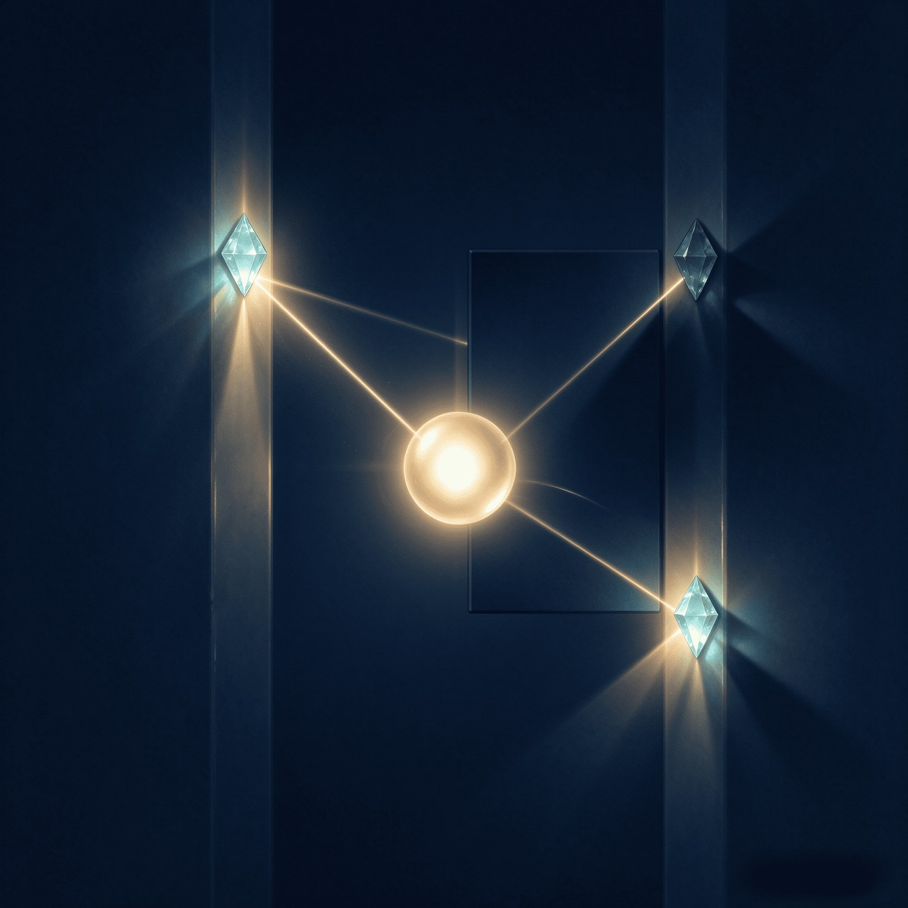
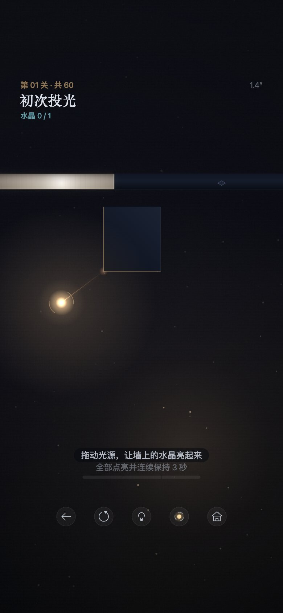
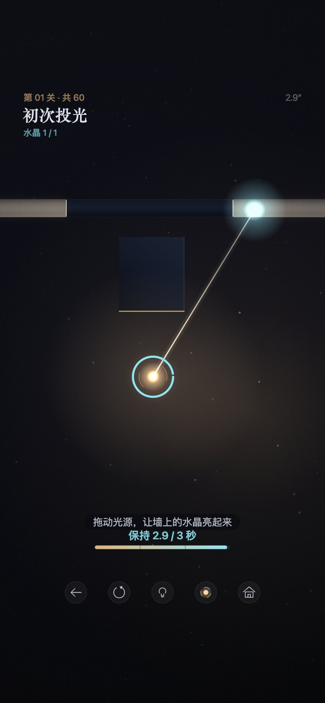
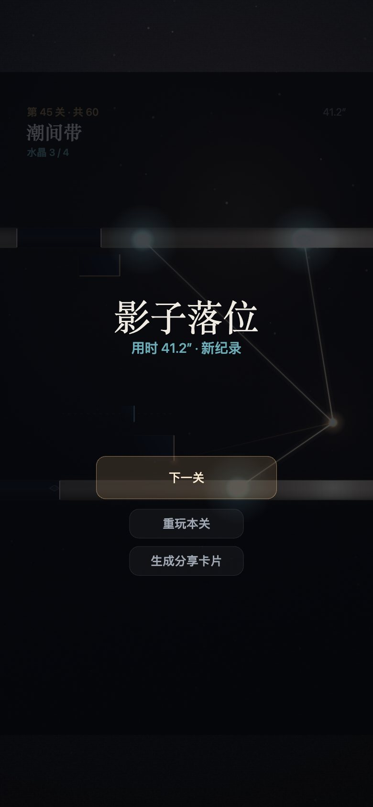
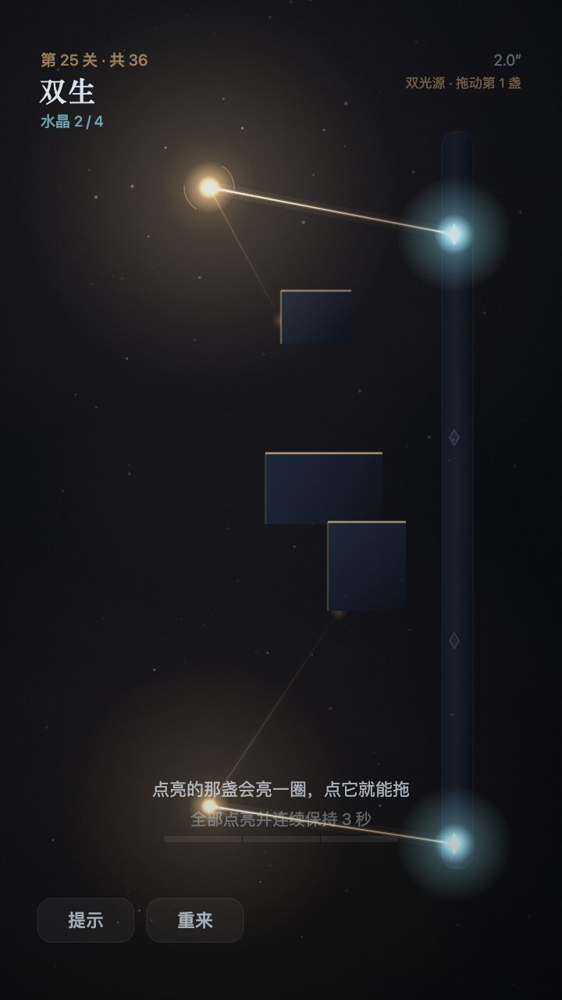
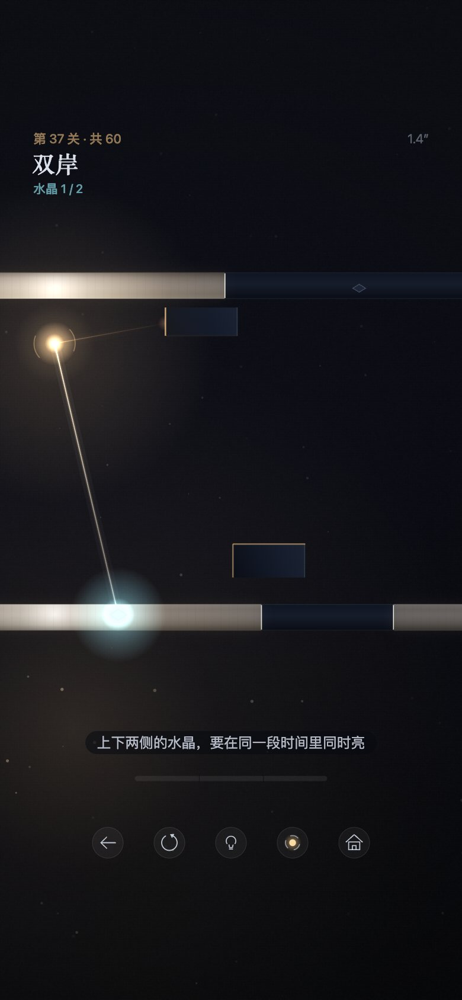
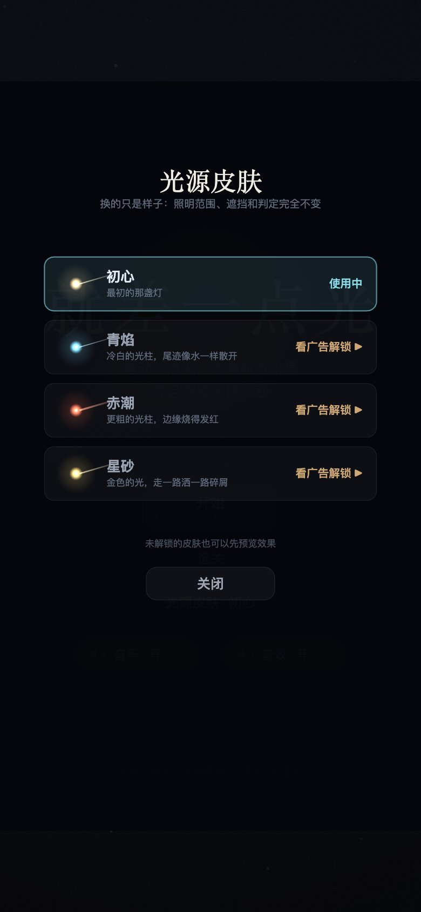
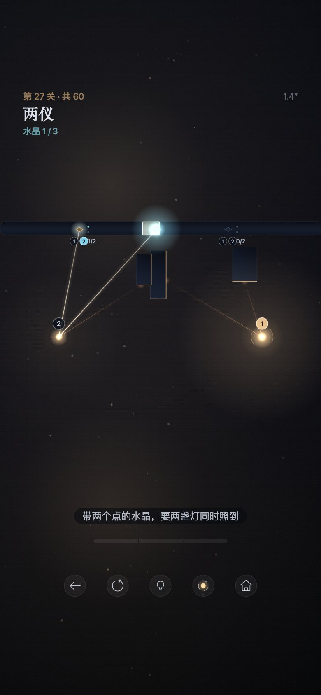
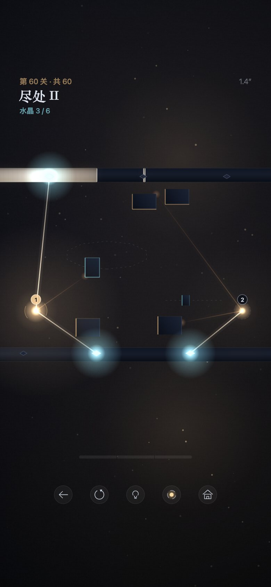

<div align="center">



# 就差一点光

**拖动一点光，点亮所有水晶，并连续保持 3 秒。**

60 关 · 单指操作 · Canvas 2D · 零美术资源 · IAA 微信小游戏

[▶ 在线试玩](https://theonlin0725.github.io/just-a-little-light/) ·
[微信小游戏工程](wechat/) ·
[设计手记](docs/DESIGN.md) ·
[迭代日志](docs/ITERATION.md) ·
[后续版本](docs/ROADMAP.md)

</div>

> 这是一个作品集仓库，不只是一个游戏 Demo。
> 比代码更想展示的，是我在几次迭代里做过的判断：为什么把通关条件改成 3 秒、为什么皮肤只能靠看广告解锁、为什么「60 关都能过」依然不够。

---

## 先玩 30 秒

你只有一盏灯，也只有一个动作：**拖动它**。

| # | 规则 | 为什么这样设计 |
| --- | --- | --- |
| 1 | 水晶分属两面墙，每颗都要被指定的灯照到 | 让「站哪里」变成空间推理，而不是乱试 |
| 2 | 所有水晶必须**同时**亮着，左右两侧一起算 | 逼玩家找折中位置，而不是逐个解决 |
| 3 | 全部亮起后，**连续保持 3 秒**才通关 | 把「扫过去碰巧亮一下」变成「稳定地站住」 |
| 4 | 任意一颗熄灭，进度**立刻归零**，不累计 | 规则可解释，失败知道为什么 |

界面上有三处进度反馈：水晶本身、光源外圈的进度环、底部进度条和秒数。没有隐藏规则，也没有随机判定。

<p align="center">
  
  
  
</p>
<p align="center"><sub>把光拖到正确的位置 → 守住 3 秒（图里是 2.9 秒）→ 结算。所有画面都是 Canvas 实时绘制，没有一张美术素材。</sub></p>

### 为什么是 IAA，而不是内购

微信小游戏最舒服的形态是「不用下载、30 秒一局、能直接发给朋友」。这决定了它不该靠卖数值赚钱。

- **广告只做激励视频，且必须由玩家主动点**：解锁皮肤、换一次提示，明码标价。
- **不卖通关、不卖数值、不做强制插屏**：默认光源永远可用，60 关全部可以零广告通关。
- **免费玩家也有完整路径**：方向提示免费；不看广告也能通关、也能玩到最后。
- **广告是加速器，不是门票**：它买到的是「表达」和「少走弯路」，不是「变强」。

> 这条边界我在需求里写得很明确：「广告只是可选辅助，不看广告也必须能够正常游玩和通关。」

---

## 01 选题：为什么是「拖光」

最开始我让 DeepSeek Harness 给了三个方向：拖光投影、蓄力纸飞机、中文 Wordle。我选了《投影》，理由很实际：

1. **一句话能讲清**：拖光源，让影子/光路对上目标。
2. **零美术成本**：画面全部由几何和光效实时生成，AI 可以直接写，不依赖素材管线。
3. **关卡即内容**：机制固定，后面只需要生产关卡，不用不断加系统。
4. **适合竖屏单手**：等电梯、坐地铁，一只手就能玩。

原型第一版很快就跑起来了，但也立刻暴露了一个结构性问题：**方块没有延伸到墙边时，光源能钻进「墙缝」，所有水晶同时可见**。从那时起，关卡就不能靠手摆，只能靠「先定一个解，再反推障碍」的生成方式。这个决定后来救了整个项目——60 关没有一关是无解的。

---

## 02 玩法系统：和 DeepSeek Harness 共创

这个项目从第一行代码到微信构建，都是我和 DeepSeek Harness 一起做的。但「一起做」不是「AI 写、我看」，而是分工明确：

| 我负责 | Harness 负责 |
| --- | --- |
| 定方向：做什么、不做什么 | 读代码、给方案、写实现 |
| 定规则：3 秒、双侧、皮肤只改外观 | 把规则变成状态机和几何计算 |
| 定体验：右手操作、别挡手指、音乐别吵 | 做布局变换、时钟修复、音频合成 |
| 定商业边界：广告不能挡路 | 接激励视频、做解锁与存档 |
| 验收：真机试玩、截图、否定「不好玩」 | 写测试、跑 60 关、生成构建产物 |
| 判断「这一关值不值得玩」 | 证明「这一关能不能过」 |

我们跑的是一个很小的循环：

```
我提需求（带验收标准）
   ↓
Harness 读代码 → 给方案 → 小步实现
   ↓
自动验证：471 项断言 / 60 关真实指针通关 / 微信包静态校验
   ↓
我在真机或截图里验收 → 提下一轮
```

### 三条协作规则

1. **用可验证的约束代替形容词。**
   「手感好一点」没法验收；「1–24 关镜像后右手操作，25–60 关逐字节不变」可以。
2. **一次只改一层。**
   几何、渲染、音频、商业化解耦。出问题能回滚，也能说清是哪一层坏了。
3. **不把「能跑」当「好玩」。**
   这是 AI 最容易越界的地方，也是我必须亲自下场的地方。

### AI 帮了我什么，又在哪里帮不上

**帮得上的：**

- 几何与投影：左右双向投影、四角取极值、移动遮挡的时间窗口。
- 关卡生成器：先定解，再反推挡板位置，自动校验 60 关。
- 测试：471 项断言，覆盖 2.9 秒不通关、中断归零、60 关可通关、皮肤不影响判定。
- 平台适配：浏览器 / 微信双端、视口、安全区、触摸状态机。
- 文档与构建：把一个原型整理成可导入开发者工具的 108 KB 小游戏包。

**帮不上的：**

- **它听不到 BGM。** 低频嗡鸣是否疲劳、水晶「叮」是否清脆，只能我在真机上判断。
- **它测不了真机手感。** 手指遮挡、拖拽跟手、右手舒适度，自动化替不了。
- **它会用「测试通过」代替「体验成立」。** 它交付了 60 关全可解，但我连续玩下来发现很多关是同一个动作——这促成了最后一轮的全量关卡审查。
- **它容易修症状，不修根因。** 光点「抽搐」一开始被当成粒子问题，真正原因是微信端把 RAF 的毫秒当秒传给了渲染。

> **AI 能证明一关可解，但只有人能判断它值不值得玩。**
> 这句话基本概括了我在这个项目里的角色。

---

## 03 四次关键迭代

### 3.1 三秒门槛：把「手快」变成「看懂」

**问题**

第一版只要所有水晶同时亮起就立刻通关。结果玩家不需要理解关卡，快速来回拖动，总有一次会扫过「全亮」的瞬间。游戏变成了拼手速。

**我的判断**

> 「目前玩家只要快速、反复拖动，就可能在目标同时亮起的瞬间直接通关，解谜感不足。」
>
> 「不要简单通过限制拖动次数或惩罚操作来防『狂拉』，应主要依靠关卡机制和持续判定提升玩法深度。」
>
> 「难度应来自观察、规划和空间推理，而不是像素级操作或纯拼手速。」

限制拖动次数、加冷却、扣体力，都是在惩罚玩家；真正该改的是**通关的定义**。

**做了什么**

- 通关条件从「瞬间全亮」改成「全亮并连续保持 3 秒」。
- 3 秒是**连续**计时，不是累计；任一水晶熄灭立即清零，重新满足从 0 开始。
- 三处反馈：水晶亮灭、选中光源外圈的进度环、底部进度条 + 秒数。
- 面板、选关、广告、切后台全部冻结仿真和计时，回来接着算，不会「看广告的时间把 3 秒混过去」。
- 只有通关触发一次，结算后停止计时。

**为什么是 3 秒**

- 1 秒太短，扫过去的惯性还在，惩罚不到「乱拖」。
- 5 秒太长，静态关会变成干等，玩家会怀疑游戏卡了。
- 3 秒刚好够玩家意识到「我站住了」，又短到愿意再试一次。
- 对移动障碍关，3 秒是一个必须等待的时间窗口，而不是碰运气的一帧。

**结果与代价**

- 60 关全部可通关，开局自动通关 0 关；测试里明确覆盖 2.9 秒失败、3.0 秒成功、中断归零。
- 代价是新手前 3 关必须把「为什么要等 3 秒」讲清楚。所以加了分级教学：只在机制首次引入的关卡出现，重玩不再打扰。
- 另一个代价是挫败感。第 4 次有效失败后会有一个很轻的灯泡引导，指向免费的方向提示；不自动播广告，不冻结关卡。

<p align="center"></p>

---

### 3.2 交互体验：从「能玩」到「单手能玩」

这一块迭代最多，因为问题都来自真机，而不是代码 review。

**第一轮真机反馈：能打开，但不像一个手机游戏**

| 问题 | 根因 | 改动 |
| --- | --- | --- |
| 720×1280 的画面缩在左上角 | 视口只按逻辑尺寸缩放，没有处理 DPR / 安全区 / 胶囊 | 统一逻辑坐标、触摸 CSS px、canvas 物理像素三套坐标 |
| 第 1 关拖动附近卡死 | 更新异常会中断 RAF 链；音频兼容问题会外溢 | 帧级错误边界 + 音频失败隔离，主循环不再被单点异常杀死 |
| 光点「抽搐」 | 微信端把 RAF 的**毫秒**当**秒**传给渲染，相位速度放大 1000 倍 | 引入视觉时钟，统一用秒；暂停不跳相 |
| 底栏「选关」点了没反应 | 命中坐标与画面坐标不一致，拖动事件抢走点击 | 统一命中测试；按下即判定，拖动结束不误触 |

**第二轮：右手友好，左侧目标**

真机上手后我发现，前期关卡的光源主要在左边，目标在右边，右手玩家要横跨屏幕，手指还会挡住光路。于是做了 **1–24 关的完整水平镜像**：目标在左，光源和操作区在右。

这不是「把画面翻一下」：墙的几何、挡板的影子、移动物的轨迹、触摸坐标、提示方向都要一起镜像。测试里用 168 组随机位置/时刻对比了镜像前后的点亮序列，并要求 25–60 关逐字节不变。

**第三轮：把左右改成上下**

镜像解决了「哪只手」，但没解决「手指挡住目标」。只要目标和光源在同一水平线上，拖动时手掌就会压住光路。

> 「当前墙面光柱与水晶主要位于左右两侧，玩家从屏幕两侧操作时容易遮住目标和光路。」

于是把**玩法世界整体旋转 90°**：单侧关的目标墙在上方，光源在下方；双侧关是上下两面墙，光源在中间。文字、按钮、弹窗不旋转，仍然是正常竖屏阅读。

这里有一个重要的工程选择：**只旋转呈现层，不关卡数据**。世界坐标还是 720×1280，墙还是竖的；`sceneToScreen` 负责把世界投到屏幕，`screenToScene` 把触摸逆变换回逻辑坐标。这样判定、提示、生成器、验证器都不用改，60 关的几何等价性可以用测试证明。

**第四轮：把上下光柱拉开**

旋转后新的问题又出现了：上下两条墙离得太近，玩法带只占屏幕中间一小条，手指一放就挡住半个关卡。

> 「光柱间距可以带动关卡几何布局调整，但要重新校验难度。」

这一轮做了三件事：

1. 沿墙方向压缩到 0.75（仿射变换，不改变遮挡/点亮关系）。
2. 可拖拽范围从「整面墙」收紧到「本关内容 ±96」。
3. 布局按内容框定，缩放从 0.76 提到约 1.15。

结果：双侧关两墙距离从 388 拉到平均 480（+24%），手机上从 256 CSS px 提到 317 CSS px。代价是旧的「理论最优距离」不再可比，第 5 轮才把距离挑战按新几何补回来。

<p align="center">
  
  
</p>
<p align="center"><sub>左：迭代前的左右布局（36 关时期）。右：旋转后的第 37 关，上下两侧同时点亮。</sub></p>

**还做了但这些不在截图上**

- 底栏固定五个图标：选关 → 重来 → 提示 → 皮肤 → 首页；视觉 48×48，命中区 92×92，按 360 CSS 宽换算仍有 46×46，互不重叠。
- 图标全部用 Canvas 路径画，不用 emoji 或图标库；不写常驻文字，桌面端悬停出名字，屏幕阅读器读隐藏的 `<button aria-label>`。
- 打开任何面板 / 选关 / 广告都冻结关卡仿真；关闭后从冻结处继续。
- 音效全部 WebAudio 合成：BGM、水晶「叮」、保持时的「滋滋」蓄力声；音乐和音效各有开关，偏好持久化。
- BGM 从低频 pad 改成五声音阶琶音，原因是真机上「低频明显、持续声较重，长时间游玩容易感到吵闹」。

---

### 3.3 皮肤系统：让广告卖「表达」，不卖「强度」

**问题**

IAA 游戏总要在某个地方放广告。放在哪里，决定了玩家觉得你是在做生意，还是在耍他。

**我的判断**

光源是玩家唯一直接控制的物体，也是屏幕上情感连接最强的对象。卖皮肤，比卖「提示次数」更体面；而皮肤如果影响照明范围，游戏就变成了付费变强。

> 「更粗、更华美默认属于视觉效果，不扩大真实照明范围，不改变遮挡计算、通关判定或解区。」
>
> 「保留始终可用的免费默认光源。」

**做了什么**

| 皮肤 | 获得方式 | 外观 |
| --- | --- | --- |
| 初心 | 默认，永远可用 | 暖白光球，细光柱 |
| 青焰 | 看激励视频解锁 | 冷白光球，光柱更细，拖尾更长 |
| 赤潮 | 看激励视频解锁 | 橙红光球，光柱最粗，边缘发红 |
| 星砂 | 看激励视频解锁 | 金色光球，绕核心撒碎光 |

- 未解锁皮肤可以**预览**，不用先看广告才知道好不好看。
- 看完广告**永久解锁**，之后自由切换；解锁和装备状态都写进存档。
- 皮肤只改绘制：光晕半径、光柱粗细、拖尾、粒子。照明范围、遮挡计算、通关判定、解区一律不变。
- 测试里对四款皮肤做了逐帧对比：同一操作下，水晶亮灭序列必须完全一致。

**为什么不是「看广告才能玩」**

- 默认皮肤永远可用，60 关全部可通关。
- 提示的第一级（方向）免费；第二级「移除一个障碍」和第三级「直接给位置」才需要广告，且教学关免费。
- 广告是模拟播放器（4.5 秒、带进度条），播放期间关卡仿真、计时、保持进度全部冻结；取消或没看完不发奖。
- 微信端已接真实 `wx.createRewardedVideoAd`，但广告位 ID 还没配置——这部分我如实标为「未验证」，不把模拟说成真实收入。

<p align="center"></p>

**这次迭代教会我的**

皮肤是「低成本、高感知」的内容：不用做新关卡、不用改平衡，却能给玩家一个继续玩和看广告的理由。但它必须建立在**不影响公平**的前提下，否则省下的内容成本会变成口碑成本。

---

### 3.4 障碍物与玩法多样性：从「换位置」到「换思考」

**问题**

第 4 轮结束时，60 关全部可解，自动化全绿。但我自己连着玩，感觉很多关是同一个动作：把光拖到某个熟悉的位置，等 3 秒。

> 「玩家用几乎相同的动作就能连续过关。」
>
> 「可解不等于解法有差异，也不等于难度不变。」

这句话是整轮迭代的起点。**「能过」是关卡的下限，不是上限。**

**我的判断**

难度可以相近，但玩家需要改变的**观察点**和**动作**必须有区别。区别要来自目标分布、遮挡结构、有效站位、调整方向、时机判断或双光源分工，不能靠换背景、换名字、简单镜像或缩小解区。

**做了什么：先让机制改变问题，再让关卡改变动作**

障碍物不是装饰，每加一种，都是在换一道题：

| 机制 | 首次出现 | 玩家要回答的新问题 |
| --- | --- | --- |
| 静态遮挡 | 第 1 关 | 光要站在哪，影子才不挡住水晶？ |
| 多目标 | 第 3 关 | 一颗水晶一条缝，怎么同时照顾？ |
| 移动遮挡 | 第 13 关 | 什么时候站进去，才能守住 3 秒？ |
| 干扰角色 | 第 19 关 | 它胀大前有前摇，什么时候躲？ |
| 双光源 | 第 25 关 | 两盏灯怎么分工，先摆哪一盏？ |
| 双侧水晶 | 第 37 关 | 上下都要亮，站位怎么折中？ |
| 组合机制 | 第 49 关起 | 两盏灯 + 两侧 + 移动 + 干扰，先规划再执行 |

**关卡不是手摆的，是反推出来的**

手填坐标一定会出现无解关。所以流程反过来：

1. 先挑一个「解」的光源位置 `L*`；
2. 把水晶按两面墙钉好，各自切出「缝」；
3. **反推**每块挡板的 y：让它在 `L*` 处投到所属墙上的影子，正好落进一条缝；
4. 有移动障碍的关，自动在「缩放 × 上下平移」里搜一遍，取「仍然留出 ≥4.2 秒干净窗口」里挡得最狠的一档；
5. 起始位置必须「开局凑不出 3 秒」，否则重选；
6. 跑校验器看解区面积、连通性、最优距离。

**第 5 轮：用审查表否定自己**

第 5 轮我没有再看截图，而是写了一个审查脚本，对**运行时关卡**（镜像 → 沿墙压缩 → 边界收紧之后）逐关计算：

- 可行解区：6px 网格 + 保持 3 秒判定，取最大连通区；
- 起点到解区的可达距离（BFS）；
- 动作向量：起点 → 解区中心的方向；
- 保持窗口：在解区中心能连续满足的最长时间；
- 相邻关相似度：动作向量余弦 + 解区中心距离。

结果发现 7 关和相邻关高度重复，全部重设计；加上第 1–3 关，一共改了 9 关。比如第 7 关原来和上一关一样「往下挪一点」，改后解区到了上端，动作向量余弦从 1.00 变成 -0.83——玩家必须换一个方向思考。

**代价与没做完的**

- 双光源关的相似度只取了第 1 盏灯的方向，不能反映「分工/顺序」的差异；25–36、38–53 的相似对只做了人工筛查，没有逐对改良。
- 第 4 关的改良效果缺少前后对比截图。
- 光源贴边时，光晕会被裁掉一部分（第 8 关最明显），还没修。

这些我都留在仓库里，没有假装 60 关已经完美。

<p align="center">
  
  
</p>
<p align="center"><sub>左：第 27 关，双光源 + 双点水晶（1/2、2/2）。右：第 60 关，全部机制叠加。</sub></p>

---

### 一条时间线

| 时间 | 版本 | 关键变化 | 触发原因 |
| --- | --- | --- | --- |
| 10-24 | v0.1 | 浏览器原型，36 关，连续保持 3 秒 | 防止「快速拖动碰巧通关」 |
| 10-25 | v0.2 | 扩到 60 关，双侧水晶，4 款皮肤，移除障碍提示，底栏五图标 | 让玩法有后半程，让广告有体面的位置 |
| 10-25 | v0.2.1 | 修首关卡死、画布左上角、音频外溢、渲染栈泄漏 | 真机：能打开，但随时可能卡死 |
| 10-25 | v0.3 | 1–24 关镜像，修时钟，BGM/叮/蓄力声，灯泡引导 | 真机反馈：右手操作、光点抽搐、太安静 |
| 10-26 | v0.4 | 全关卡旋转为上下，光柱拉开 +24%，第 1–3 关重做 | 真机反馈：手指遮挡目标、玩法区太局促 |
| 10-26 | v0.5 | 全量审查 60 关，重设计 7 关，距离挑战回归，正式包 | 我自己玩出来的「解法重复」 |

更细的逐轮改动见 [迭代日志](docs/ITERATION.md) 和 `docs/changelog/` 里的原始交接文档。

---

## 04 我如何判断一关「值得玩」

可解只是必要条件。我现在会问四个问题：

1. **观察点变了吗？** 玩家进关后，第一眼要注意的东西是否和上一关不同。
2. **动作变了吗？** 是换了一个方向、换了一个时机，还是只在同一个位置微调？
3. **失败可解释吗？** 玩家熄灭时，能不能说出「因为我挡住了哪条缝」。
4. **有没有第二条路？** 双光源关的先后顺序、双侧关的折中站位，是否允许不同的解法。

这也是为什么仓库里既有「生成器」又有「审查器」：

- `scripts/gen-levels.mjs` 保证**可解**；
- `scripts/audit-levels.mjs` 检查**是否重复**；
- `scripts/validate-levels.mjs` 检查**解区、开局、动态窗口**；
- `tests/playthrough60.test.mjs` 用真实指针事件把 60 关跑一遍。

自动化能守住下限，上限还是得靠人玩。

---

## 05 后续版本：奖励货币 + 更多玩法

### 5.1 光尘：给广告之外第二条路

现在的皮肤只能看广告解锁，广告是唯一入口。这有两个问题：

- 不想看广告的玩家，永远拿不到皮肤；
- 广告变成了「门票」，而不是「加速器」。

**光尘**（暂定名）是一个只通过游玩获得的软货币，不能充值，不能买数值。

**产出**

| 行为 | 光尘 | 上限 |
| --- | ---: | --- |
| 首次通关一关 | +10 | 每关一次 |
| 每日首胜 | +30 | 每日 1 次 |
| 看完激励视频 | +15 | 每日 3 次 |
| 分享成绩 | +10 | 每日 1 次 |
| 无重开一次通关 | +15 | 每关一次 |
| 每周挑战 | +100 | 每周 1 次 |
| 新手启动 | +100 | 一次性 |

**消耗**

| 商品 | 价格 | 说明 |
| --- | ---: | --- |
| 皮肤「青焰 / 赤潮 / 星砂」 | 600 / 800 / 1000 | 也可看广告直接解锁，两条路并存 |
| 提示券（方向 / 定位） | 60 / 120 | 免费方向仍然保留，券是省时间 |
| 移除障碍券 | 80 | 替代「看广告才能移除」的单一路径 |
| 光轨 / 尾迹 | 200 | 纯外观，不影响判定 |

**设计原则**

- **广告产出约占日均一半，且有硬上限**：活跃玩家一天约 85–95 光尘，其中广告最多 45；不看广告约 40–50，两周左右也能买到第一款皮肤。
- **只做软货币，不充值**：IAA 项目不引入内购，避免 Pay-to-Win 和合规复杂度。
- **所有消耗品都不影响解谜**：提示和移除障碍是「降低摩擦」，不是「跳过关卡」。
- **先本地，后云端**：MVP 用本地存档；有留存数据后再考虑云同步和防作弊。

**风险**

- 通胀：一次性首通奖励有 600，必须控制皮肤价格和后续产出。
- 刷广告：每日 3 次的硬上限，且广告期间冻结计时，不能「用广告换进度」。
- 存档作弊：本地存档可改；在排行榜/云端上线前，不把货币做成可交易资产。

**要看的指标**：D1 / D7、广告观看率、皮肤解锁率、提示使用率、第 10 关到达率。数值先用上面这版跑，再按真实数据调。

### 5.2 更多玩法：仍然只用一个动作

新增玩法必须满足一个约束：**局内不增加按钮，仍然只靠拖光**。否则它就不是《就差一点光》了。

| 方向 | 玩法 | 为什么适合 | 成本 |
| --- | --- | --- | --- |
| 每日一关 | 每天同一张种子关卡，3 次机会，可分享战绩 | 天然日活，开发成本低 | 低 |
| 无尽模式「逐光」 | 连续关卡，每 5 关加一个机制，3 条命 | 复用生成器，拉长单局 | 中 |
| 新机制「折射」 | 棱镜把光分成两束，颜色水晶只吃对应色 | 仍是拖光，但要多想一层 | 中 |
| 镜面 / 单向玻璃 | 光可以被反射、只能从一个方向穿过 | 改变「光路」而非「站位」 | 中 |
| 好友排行 / 影子回放 | 看好友的最短路径，或挑战自己的影子 | 分享与攀比，复用现有成绩 | 中高 |
| 关卡工坊 | 玩家自己摆关卡，生成器保证可解 | UGC 拉长生命周期 | 高 |

**优先级**

1. **v1.1**：光尘 + 每日一关 + 埋点。先把留存和广告价值跑出来。
2. **v1.2**：折射机制 12 关 + 无尽模式。给核心玩家新内容。
3. **v1.3**：好友排行 + 影子回放 + 皮肤扩展。做社交和长期目标。
4. **更远**：关卡工坊。必须先有审查器和举报机制，否则内容质量不可控。

**北极星指标**：不是「广告看了多少次」，而是「有多少人玩到第 10 关，并且第二天还回来」。广告收入是留存的结果，不是原因。

---

## 06 工程与验证

不是「AI 生成的一坨代码」：核心逻辑有测试，关卡有生成器和校验器，微信包有静态检查。

| 层 | 文件 | 作用 |
| --- | --- | --- |
| 几何 | `src/geometry.js` | 双向投影、线段求交、影子区间、移动遮挡 |
| 状态 | `src/game.js` | 持续判定、双光源、双侧目标、提示、移除、广告、皮肤 |
| 渲染 | `src/render.js` | 双墙、光柱、挡板、水晶、皮肤、进度条、弹窗 |
| 关卡 | `src/levels.js` | 60 关数据（脚本生成，不手改） |
| 生成 | `scripts/gen-levels.mjs` | 配方 → 反推挡板 → 校验 → 写关卡 |
| 审查 | `scripts/audit-levels.mjs` | 解区面积、动作向量、相邻相似度 |
| 平台 | `src/platform.js` / `src/main-wx.js` | 浏览器 / 微信的画布、触摸、存储、广告 |
| 时钟 | `src/clock.js` / `src/loop.js` | 固定步长，低帧率下 3 秒仍等于真实 3 秒 |

**验证结果（本仓库对应版本）**

```
npm test             471 项断言，0 失败
                     60/60 关真实指针通关；0 关开局自动通关
npm run validate     60/60 可解、起点可达、动态窗口正常
npm run verify:wechat 静态检查全部通过
微信正式包            110,299 bytes（约 108 KB），buildId d41bb877a15d
```

测试覆盖的典型场景：

- 单帧点亮不通关；0.5 秒、2.9 秒不通关；超过 3 秒通关。
- 中断后进度归零、重新满足不累计、通关后计时停止且不重复结算。
- 双光源点选、拖动只影响选中那盏；双侧水晶在同一 3 秒窗口内判定。
- 四款皮肤下，同一操作的亮灭序列完全一致。
- 广告期间冻结计时；切关作废旧回调；取消 / 未看完不发奖。
- 旧存档迁移（含 36 关 → 60 关的解锁修正）、皮肤持久化、选关状态。
- 60 关在设计解位置都能通关；20 关在测试中需要保持超过 4 秒（等待移动障碍窗口，最长约 16 秒）。

**关卡是怎么保证不是无解的**

1. 先定解 `L*`，再反推挡板；
2. 移动障碍在「缩放 × 平移」里搜索，保留 ≥4.2 秒干净窗口；
3. 起始位置必须凑不出 3 秒；
4. 校验器逐关扫解区、连通性、动态时间窗口；
5. 测试用真实指针事件从起点走到解区，再推进到通关。

---

## 07 诚实边界

这个仓库里哪些是已验证的，哪些还不是，我写清楚：

| 项 | 状态 |
| --- | --- |
| 60 关可通关 | ✅ 自动化 + 真实指针事件，60/60 |
| 微信小游戏包可导入 | ✅ 构建产物在 `wechat/`，静态校验通过 |
| 真机手感 | ⚠️ 我在真机上玩过并提了三轮反馈；没有做多机型矩阵 |
| 真实激励视频 | ⚠️ 代码已接 `wx.createRewardedVideoAd`，广告位 ID 未配置，未产生真实广告 |
| 体验版 / 正式版 | ❌ 尚未发布；仓库只有可导入的构建包 |
| 好友排行 / 云存档 | ❌ 未做，当前只有本地存档 |
| 双光源关的「解法差异」审查 | ⚠️ 只做了人工筛查，未逐对改良 |
| 音频听感 | ⚠️ 由我在真机判断；自动化只能验证状态机，不能验证好不好听 |

我不想用「已完成」三个字盖住这些。对一个要拿去展示的项目来说，知道边界在哪，比假装没有边界更重要。

---

## 本地运行

浏览器版零依赖，Node 18+ 即可：

```bash
node server.mjs
# → http://127.0.0.1:5183
```

微信小游戏版（构建产物已提交，可直接导入开发者工具）：

```bash
npm install          # 只为构建工具 esbuild
npm run build:wechat # → wechat/（正式）+ wechat-dev/（QA，自测用）
npm run verify:wechat
```

导入方式、AppID、广告位、真机调试步骤见 [微信小游戏说明](docs/WECHAT.md)。

**调试参数**（浏览器）：

| 参数 | 作用 |
| --- | --- |
| `?level=45` | 直接进第 45 关 |
| `?light=150,660` | 把所有光源钉在指定坐标 |
| `?sim=6` | 先快进 6 秒游戏时间再画 |
| `?win=41.2` | 直接显示结算（不写存档） |
| `?modal=hint\|ad\|skins` | 直接打开某个弹窗 |
| `?phase=levels` | 直接打开选关 |
| `?remove=1` | 直接进入移除障碍模式 |
| `?skin=azure` | 临时换皮肤（不写存档） |
| `?selftest=1` | 跑浏览器端 28 项自测 |

---

## 文档索引

| 文档 | 内容 |
| --- | --- |
| [设计手记](docs/DESIGN.md) | 3 秒、皮肤、障碍、交互背后的完整判断 |
| [迭代日志](docs/ITERATION.md) | 五轮迭代的逐项改动、原因与遗留问题 |
| [关卡设计](docs/LEVELS.md) | 60 关分组、机制表、第 37–60 关设计简表 |
| [工程说明](docs/ENGINEERING.md) | 架构、生成器、测试与微信适配 |
| [微信小游戏](docs/WECHAT.md) | 导入、构建、AppID、广告位与真机清单 |
| [后续版本](docs/ROADMAP.md) | 光尘经济、每日一关、无尽模式与优先级 |
| [共创记录](docs/BRIEFS.md) | 我给 Harness 的原始需求摘录 |
| [原始交接文档](docs/changelog/) | 第 2–5 轮的完整 changelog |
| [关卡审查表](docs/audit/LEVEL-AUDIT.md) | 60 关逐关的可行解区与相似度 |
| [60 关逐关记录](docs/audit/PLAYTHROUGH-60.md) | 逻辑层 / 交互层 / 真机栏（真机明确标未测） |

---

## 关于这个项目

- 玩法、方向、验收与商业化边界：我。
- 实现、关卡生成、自动化验证、微信适配与文档：和 DeepSeek Harness 共创。
- 技术栈：原生 Canvas 2D + WebAudio + 零依赖 ESM；微信端用 esbuild 打包成单文件 `game.js`。
- 仓库里的截图来自当前版本；`before-*.jpg` 是迭代前的存档，用来对照。

如果这个项目让你想聊「小游戏怎么把一个小动作做深」，欢迎开 Issue 或找我聊。

---

<sub>本仓库用于作品展示。除引用的第三方依赖外，游戏代码、关卡、截图与文案版权归作者所有；欢迎阅读与交流，未经许可请勿将游戏或素材商用、重新发行。</sub>
