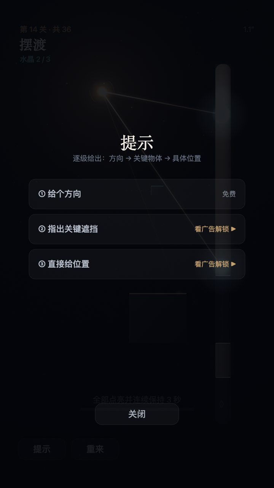

# 设计手记：把一个小动作做深

> 这份文档记录《就差一点光》的设计判断，不按时间顺序，而按问题来组织。
> 想先看每轮改了什么，去 [迭代日志](ITERATION.md)。

## 0. 一句话

玩家只有一盏灯，也只有一个动作：拖动它。目标不是「把光拖到某个点」，而是**找到一个能站住 3 秒的位置**。

这个设计约束听起来很窄，但它逼出了后面所有的深度：遮挡、多目标、移动障碍、干扰角色、双光源、双侧水晶，全部都必须在不增加按钮、不增加手势的前提下成立。

## 1. 为什么选「拖光」

### 1.1 微信小游戏的形态约束

微信小游戏真正的优势不是「能做成 App」，而是：

- 不用下载，点开就玩；
- 一局 30 秒到 2 分钟，适合等电梯、坐地铁；
- 能直接发到群里，截图自带传播力。

所以它不适合做重度养成、复杂战斗、长剧情。它适合：**一句话能讲清、一根手指能玩、一关一张截图**。

### 1.2 三个候选，为什么选投影

最开始让 DeepSeek Harness 给了三个方向：

| 方向 | 操作 | 技术难点 | 传播力 | 美术成本 |
| --- | --- | --- | --- | --- |
| 拖光投影 | 单指拖 | 几何投影、关卡生成 | 强（截图好看） | 零 |
| 蓄力纸飞机 | 按住/松手 | 手感调优 | 强（比分） | 低 |
| 中文 Wordle | 打字 | 词库与反馈规则 | 极强（日更） | 零 |

我选投影，理由不是「最有趣」，而是**最适合这个团队和这个阶段**：

1. 玩法一句话能讲清：拖光源，让光/影子对上目标。
2. 所有画面都能用 Canvas 实时画出来，不依赖美术管线。
3. 关卡是数据，后面只需要生产内容，不用不断加系统。
4. 竖屏单手，符合微信小游戏的使用场景。

### 1.3 第一个结构性问题

原型跑起来后，校验器立刻暴露了一个问题：**方块没有延伸到墙边时，光源能钻进「墙缝」，所有水晶同时可见**。

这不是「调一下参数」能解决的，而是关卡结构错了。后来定下的规则是：

- 挡板必须够深，不能留下光源可以绕过去的缝；
- 双侧关把可拖拽区夹在中间，两侧挡板带钻不进墙缝；
- 不能手填坐标，必须「先定解，再反推障碍」。

这三个规则一直用到 60 关。

## 2. 三秒门槛：把「手快」变成「看懂」

### 2.1 问题不是玩家太快，是规则太浅

第一版只要全亮就通关。玩家很快发现：不需要理解关卡，快速来回拖动，总有一次会扫过「全亮」的瞬间。

这不是玩家的错，是规则给了错误的激励。**当「碰巧」比「看懂」更便宜时，玩家一定会选择碰巧。**

### 2.2 为什么不是限制操作

最直接的反应是加限制：限制拖动次数、加冷却、扣体力、判定手速。但这些都是在惩罚玩家，而且会把「解谜游戏」变成「资源管理游戏」。

我当时的判断：

> 「不要简单通过限制拖动次数或惩罚操作来防『狂拉』，应主要依靠关卡机制和持续判定提升玩法深度。」
>
> 「难度应来自观察、规划和空间推理，而不是像素级操作或纯拼手速。」

所以改的是**通关的定义**，不是玩家的手。

### 2.3 3 秒解决了什么

- **把「经过」变成「站住」**：扫过去不算，必须找到一个稳定位置。
- **让遮挡有时间维度**：移动障碍不再是「碰运气」，而是要等一个 ≥3 秒的窗口。
- **让失败可解释**：水晶熄灭 → 进度归零，玩家知道「我刚才挡住了哪条缝」。
- **制造紧张感**：2.9 秒的截图比「通关」更有传播力。

### 2.4 为什么是 3 秒，不是 1 秒或 5 秒

| 时长 | 问题 |
| --- | --- |
| 1 秒 | 太短，扫过去的惯性还在，惩罚不到「乱拖」 |
| 3 秒 | 刚好够意识到「我站住了」，又短到愿意再试一次 |
| 5 秒 | 静态关变成干等，玩家会怀疑游戏卡了 |

3 秒还有一个隐形好处：它和移动障碍的周期配合得很好。设计移动关时，要求至少留出 4.2 秒的干净窗口，实际通关只需 3 秒——留 1.2 秒的容错，玩家不会觉得「必须卡帧」。

### 2.5 反馈必须有三层

只有底部进度条不够，因为玩家的注意力在光源和目标上。所以：

1. **水晶本身**：亮 = 青色，半满足 = 琥珀色，熄灭 = 暗。
2. **选中光源外圈**：一圈进度环，跟着 3 秒走。
3. **底部进度条 + 秒数**：给一个明确的数字，2.9 / 3。

三层反馈的好处是：玩家不用盯着一个角落，也能知道现在差多少。

### 2.6 代价

- 新手需要教学：前 3 关必须把「同时亮 + 保持 3 秒」讲清楚。
- 挫败感更高：第 4 次有效失败后，加了一个很轻的灯泡引导，指向免费方向提示；不自动播广告，不冻结关卡。
- 面板/广告/切后台必须冻结计时，否则玩家会「用看广告的时间混过 3 秒」——这条在测试里有专门断言。

## 3. 交互：先让手不挡眼睛

### 3.1 三个真机问题

第一版在浏览器里看起来没问题，到了真机：

1. 画面缩在左上角，右边和下边大片空白；
2. 第 1 关拖动附近卡死；
3. 光点「抽搐」，动效不顺。

第 1、2 个是适配和稳定性问题，第 3 个查到最后是一个很具体的 bug：**微信端把 RAF 的毫秒时间戳直接当秒传给了渲染**，所有 `sin(time*2.2)` 的相位速度被放大 1000 倍。浏览器入口一直有 `/1000`，所以只在微信端出现。

这教会我一件事：**「AI 说修好了」不算，必须找到可复现的根因。** 删粒子、降画质都能让画面「看起来不抖」，但那不是修复。

### 3.2 右手友好：1–24 关镜像

真机上手后，前期关卡的光源在左边、目标在右边，右手玩家要横跨屏幕，手指还会挡住光路。

解法是把 1–24 关做**完整水平镜像**：目标在左，光源和操作区在右。不是把 canvas 翻一下，而是把世界坐标、墙的几何、挡板、移动轨迹、触摸坐标、提示方向一起镜像。

为什么只镜像 1–24：

- 25–60 关有双光源、双侧水晶，布局更复杂，整体镜像会改变谜题；
- 前期关是「右手第一印象」，收益最大；
- 25–60 关保持逐字节不变，避免擅自改变已验证的难度。

### 3.3 上下布局：解决手指遮挡

镜像解决了「哪只手」，但没解决「手指挡住目标」。只要目标和光源在同一水平线上，拖动时手掌就会压住光路。

于是把**玩法世界整体旋转 90°**：

- 单侧关：目标墙在上方，光源在下方；
- 双侧关：上下两面墙，光源在中间；
- 文字、按钮、弹窗不旋转，仍然是正常竖屏阅读。

关键工程选择：**只旋转呈现层，不关卡数据**。世界坐标还是 720×1280，墙还是竖的；`sceneToScreen` 把世界投到屏幕，`screenToScene` 把触摸逆变换回逻辑坐标。这样判定、提示、生成器、验证器都不用改，60 关的几何等价性可以用测试证明。

### 3.4 把光柱拉开

旋转后新的问题：上下两条墙离得太近，玩法带只占屏幕中间一小条。

这一轮做了三件事：

1. **沿墙压缩**：把每关沿墙方向的坐标压到 0.75。仿射变换保持共线与相交，所以遮挡/点亮关系逐点不变。
2. **收紧可拖拽范围**：从「整面墙」改成「本关内容 ±96」。
3. **按内容框定布局**：缩放 = min(内容长边适配, 可用高适配, 1.22)。

结果：双侧关两墙距离从 388 拉到平均 480（+24%），手机上从 256 CSS px 提到 317 CSS px。

代价：沿墙压缩改变了路径长度，旧的「理论最优距离」不再可比。第 5 轮把压缩移进生成器，按最终几何重算距离，并把标签从「理论最优」改成「参考距离」。

### 3.5 底栏：五个图标，不写文字

底栏固定五个图标：**选关 → 重来 → 提示 → 皮肤 → 首页**。

- 视觉 48×48，命中区 92×92；按 360 CSS 宽换算仍有 46×46，五个热区互不重叠。
- 图标全部用 Canvas 路径画，不用 emoji、Unicode 符号或图标库。
- 不写常驻文字；桌面端悬停出名字，屏幕阅读器读隐藏的 `<button aria-label>`。
- 点按钮只处理点击，不会同时把光源拖起来；拖动结束落在按钮上也不会误触。
- 打开任何面板 / 选关 / 广告都冻结关卡仿真，关闭后从冻结处继续。

### 3.6 音频：从「低频嗡鸣」到「稀疏旋律」

第一版 BGM 是三个低音正弦叠加，真机上「低频明显、持续声较重，长时间游玩容易感到吵闹」。

改成五声音阶琶音：0.62 秒一音、每 4 音略延长、每 8 音留空拍，三角波 + 轻微失谐泛音，短衰减包络，一条 0.27 秒反馈延时做空间感。低八度只在乐句起点轻轻托底，不再是持续低音。

音效分三套：

- 水晶第一次亮起：短促的「叮」；
- 全部满足、开始保持：带限噪声的「滋滋」蓄力声，强度随进度增加；
- 通关：收束音。

音乐和音效各有开关，偏好写进存档。音频失败一律静音降级，不影响主循环。

## 4. IAA：广告只能卖「表达」，不能卖「强度」

### 4.1 为什么是 IAA

微信小游戏的变现路径基本是 IAA（广告）或 IAP（内购）。这个项目选 IAA：

- 玩法是解谜，不适合卖数值；
- 用户是碎片时间，付费意愿低；
- 没有内购，少一层合规与支付复杂度；
- 广告可以做得「自愿、有明确回报」，不破坏体验。

### 4.2 广告放在哪

只做**激励视频**，不做强制插屏、不做 banner。两个位置：

1. **皮肤解锁**：看完广告永久解锁一款光源皮肤。
2. **提示升级**：第二级「移除一个障碍」、第三级「直接给位置」。

第一级「给个方向」永远免费。

  

旧版提示的第二级是「指出关键遮挡」；后来改成「移除玩家自己选的障碍」，把选择权还给玩家。这张是迭代存档。

### 4.3 皮肤为什么只改外观

光源是玩家唯一直接控制的物体，也是屏幕上情感连接最强的对象。卖皮肤，比卖「提示次数」更体面。

但如果皮肤影响照明范围，游戏就变成了付费变强。所以定死：

> 「更粗、更华美默认属于视觉效果，不扩大真实照明范围，不改变遮挡计算、通关判定或解区。」

测试里对四款皮肤做了逐帧对比：同一操作下，水晶亮灭序列必须完全一致。

### 4.4 广告的「不打扰」原则

- 广告必须由玩家主动点，不自动播放。
- 播放期间关卡仿真、计时、保持进度全部冻结。
- 取消 / 没看完 / 切关，都不发奖，也不会误伤新关卡（有令牌校验）。
- 没有广告位时，提示面板明确说「广告暂不可用」，不诱导点击必然失败的入口。
- 60 关全部可以零广告通关，默认皮肤永远可用。

### 4.5 还没做到的

- 微信端已接真实 `wx.createRewardedVideoAd`，但广告位 ID 未配置，没有真实广告收入。
- 没有做广告频控的长期数据，只有「每日 3 次」这种拍脑袋上限（见 [路线图](ROADMAP.md)）。
- 没有做「广告失败/无填充」的完整线上监控，只有本地状态机测试。

## 5. 关卡：可解只是下限

### 5.1 生成器：先定解，再反推

手填坐标一定会出现无解关。流程反过来：

1. 先挑一个「解」的光源位置 `L*`；
2. 把水晶按两面墙钉好，各自切出「缝」；
3. 反推每块挡板的 y，让它在 `L*` 处投到所属墙上的影子，正好落进一条缝；
4. 有移动障碍的关，自动在「缩放 × 上下平移」里搜一遍，取「仍然留出 ≥4.2 秒干净窗口」里挡得最狠的一档；
5. 起始位置必须「开局凑不出 3 秒」，否则重选；
6. 跑校验器看解区面积、连通性、最优距离。

### 5.2 机制的顺序

| 机制 | 首次出现 | 玩家要回答的新问题 |
| --- | --- | --- |
| 静态遮挡 | 1 | 光要站在哪，影子才不挡住水晶？ |
| 多目标 | 3 | 一颗水晶一条缝，怎么同时照顾？ |
| 移动遮挡 | 13 | 什么时候站进去，才能守住 3 秒？ |
| 干扰角色 | 19 | 它胀大前有前摇，什么时候躲？ |
| 双光源 | 25 | 两盏灯怎么分工，先摆哪一盏？ |
| 双侧水晶 | 37 | 上下都要亮，站位怎么折中？ |
| 组合机制 | 49 起 | 两盏灯 + 两侧 + 移动 + 干扰，先规划再执行 |

顺序的原则：**每加一种机制，换一道题，而不是加一个数值。**

### 5.3 第 5 轮：用审查表否定自己

第 4 轮结束时，60 关全部可解，自动化全绿。但我自己连着玩，感觉很多关是同一个动作：把光拖到某个熟悉的位置，等 3 秒。

> 「可解不等于解法有差异，也不等于难度不变。」

于是写了一个审查脚本，对运行时关卡逐关计算：

- 可行解区：6px 网格 + 保持 3 秒判定，取最大连通区；
- 起点到解区的可达距离（BFS）；
- 动作向量：起点 → 解区中心的方向；
- 保持窗口：在解区中心能连续满足的最长时间；
- 相邻关相似度：动作向量余弦 + 解区中心距离。

结果发现 7 关和相邻关高度重复，全部重设计；加上第 1–3 关，一共改了 9 关。

| 关 | 原来与谁重复 | 改后要改变什么 | 相似度变化 |
| --- | --- | --- | --- |
| 4 三影 | 5 交叠，同为「向上找位」 | 解移到墙的最下端，贴着底边走 | cos 1.00 → 仍 0.94，但距离拉大 |
| 7 窄门 | 6 小满，cos 1.00 | 解改到上端，先贴墙再往上 | 1.00 → -0.83 |
| 8 漏光 | 7 窄门，cos 1.00 | 解贴到墙边最下端，离墙近才漏得过 | 1.00 → -0.88 |
| 10 密林 | 9 对峙，cos 0.98 | 解移到上端并往外退 | 0.98 → -0.89 |
| 11 心宿 | 10 密林，cos 1.00 | 四目标的解放到最上端，长对角 | 1.00 → -0.80 |
| 13 走影 | 12 回路，cos 1.00 | 解移到另一端并等移动挡板让开 | 1.00 → 0.93 |
| 14 摆渡 | 13 走影，cos 0.99 | 解移到挡板另一侧，等船走到头 | 0.99 → 0.99（同为上行，但窗口位置不同） |

### 5.4 没做完的

- 双光源关的相似度只取了第 1 盏灯的方向，不能反映「分工/顺序」的差异；25–36、38–53 的相似对只做了人工筛查，没有逐对改良。
- 第 4 关的改良效果缺少前后对比截图。
- 光源贴边时，光晕会被裁掉一部分（第 8 关最明显），还没修。

## 6. 我评判一关的四个问题

1. **观察点变了吗？** 玩家进关后，第一眼要注意的东西是否和上一关不同。
2. **动作变了吗？** 是换了一个方向、换了一个时机，还是只在同一个位置微调？
3. **失败可解释吗？** 玩家熄灭时，能不能说出「因为我挡住了哪条缝」。
4. **有没有第二条路？** 双光源关的先后顺序、双侧关的折中站位，是否允许不同的解法。

自动化能守住下限（可解、不自动通关、动态窗口），上限还是得靠人玩。

## 7. 如果重来一次

- **会更早做关卡审查**：生成器保证可解之后，就应该立刻做「相似度」审查，而不是等 60 关都做完。
- **会更早做真机测试**：时钟 bug、手指遮挡、音频疲劳，都是真机才暴露的。
- **会先定商业化边界**：皮肤只改外观、广告不挡路，这些规则如果一开始就写死，后面能少改很多。
- **不会做 60 关**：先做 30 关，把「每日一关」和「货币系统」跑通，再扩内容。内容是成本最低的护城河，也是最容易做重复的部分。
