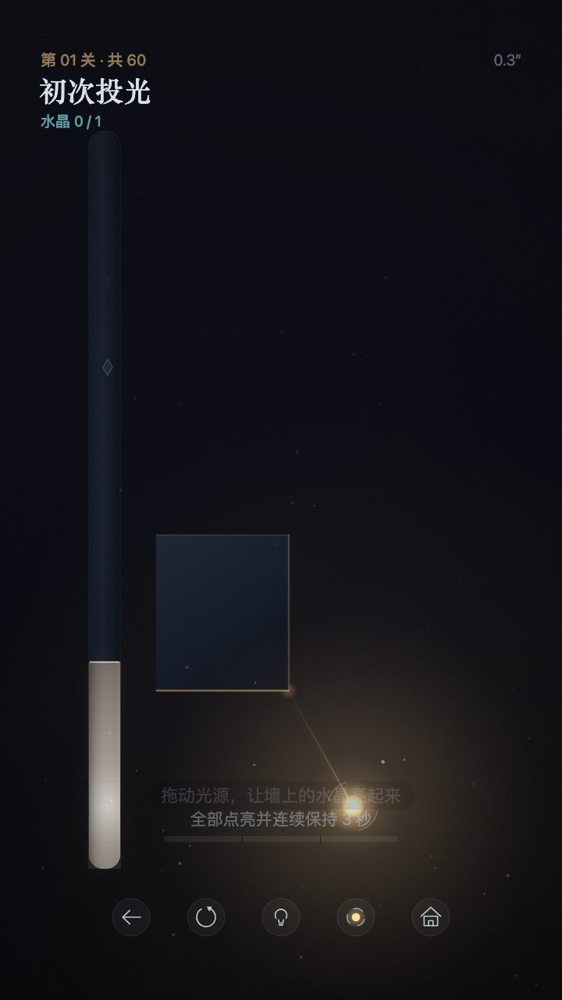

# 第二轮真机体验修改：A/B/C/D 交付说明

> 日期：2026-10-25。基于"能真机运行"的版本增量修改，未重搭工程，上一轮稳定性修复全部保留。
> **真机项一律未测**（本机没有设备），下文如实标注。

## 本轮采用的口径（可配置，需你确认）

| 项 | 采用值 | 位置 |
|---|---|---|
| 镜像范围 | **1–24 关**（25–60 不动） | `src/levels-live.js` `MIRROR_THROUGH = 24` |
| 反射轴 | `x = 720/2 = 360`（整世界反射） | `src/mirror.js` |
| 有效失败 | 一次"全亮→开始保持"且峰值 ≥ **0.3 秒**，随后熄灭且未通关 | `src/nudge.js` `HELP_NUDGE.minHoldSeconds` |
| 触发次数 | **第 5 次**有效失败 | `HELP_NUDGE.failedAttempts` |
| 显示时长 | 6 秒 | `HELP_NUDGE.visibleSeconds` |
| 频控 | 每局 1 次；同关会话 2 次；重开后 60 秒冷却 | `maxShowsPerRun / maxShowsPerLevelSession / restartCooldownSeconds` |

## A. 前 24 关镜像（左目标 / 右操作）

- 新增 `src/mirror.js`：纯函数镜像灯 start/goal、水晶、挡板、移动物轨迹与局部形状、bounds、墙几何。
- 新增 `src/levels-live.js`：**唯一**的镜像入口，`LEVELS = RAW.map(id<=24 ? mirrorLevel : identity)`；游戏、渲染、内容层、验证器都读它。
- 墙：右墙 `cx=582 / x=566` 精确反射为 `cx=138 / x=114`，1–24 关只画这面墙（不再画无用的第二面）。
- 移动物：轨迹用世界反射，局部形状只取负 `x` 并倒序；**清掉 `_path` 预编译缓存**，否则镜像后仍按旧坐标运动（这条是本轮实测抓到的坑）。
- 25–60 关数据逐字节未变（`tests/mirror.test.mjs` 断言）。
- 证据：`tests/mirror.test.mjs` 76 项（含 168 组随机位置/时刻点亮序列一致、两次镜像还原、轨迹镜像），`tests/playthrough60.test.mjs` 60/60 真实指针通关。
- 未测：真机右手遮挡、1/3/12/13/16/19/24 重点关的真机手感。



## B. 光点抽搐 / 动效不顺

**已定位到一个确定的单位错误**：`main-wx.js` 把 RAF 的**毫秒**时间戳直接当**秒**传给 `draw()`，
渲染里所有 `sin(time*2.2)` 之类相位速度被放大约 1000 倍 —— 正是"抽搐"的样子。
（浏览器入口 `main.js` 一直有 `/1000`，所以只在微信端出现。）

修复：
- 新增 `src/clock.js`：视觉时间只用秒，单调累计，单帧限幅 50ms，后台/暂停冻结。
- `draw(ctx, game, clock.time)` 两端统一；`drawWin` 的淡入改用游戏时钟 `g.t - g.winAt`，不再跨时钟域相减。
- 画质开关真正接线：`shadows / trails / beams` 之前只在配置里、render 里无条件执行，现在逐项生效。
- 证据：`tests/clock.test.mjs` 10 项（毫秒→秒、30/60/120fps 同时刻相位一致、暂停不跳相、卡顿限幅）。
- 未做：第 16 关修复前后真机录像与帧率对照（需要设备）。

## C. BGM + 水晶"叮" + 读秒"滋滋滋"

- **BGM**：程序化 pad（三个低音正弦 + 低通 + 0.125Hz 呼吸），无外部素材、无网络依赖；音量 0.045，3 秒淡入。
- **蓄力声**：一段 0.8 秒噪声 buffer 常驻循环 → 带通 → 增益；`setHold(k)` 只调参数，不新建振荡器；
  中断 60ms 淡出，暂停/切关/通关/关闭音效都会清理，不会留幽灵声。
- **开关**：首页新增「音乐 · 开/关」「音效 · 开/关」两个胶囊（不改底栏五图标顺序），偏好写入存档 `save.audio`。
- 生命周期：`onHide` 挂起音频上下文，`onShow` 恢复；BGM 与短音效走同一条 master。
- 证据：`tests/stability.test.mjs` 音频隔离 5 项 + `playthrough60` 全关跑通（说明失败不会阻断主循环）。
- **未测**：真机是否能听到、静音开关组合、音质与爆音 —— 这必须你听。

## D. 第 5 次有效失败后的灯泡引导

- 新增 `src/nudge.js`：状态机 + 频控，纯函数，18 项单测。
- 显示：底栏真实灯泡外圈呼吸环 + 上方浮动小箭头 + 一条非模态文案；不复制假按钮、不冻结关卡、不吞触摸。
- 文案三态：无广告位 → "点灯泡，获取免费方向提示"；教学关且有广告 → "点灯泡，看看方向或移除障碍"；其余 → "试试灯泡：免费方向，也可看广告移除障碍"。
- 时机：拖动中不弹（等松手）、保持进行中不弹、通关不弹、面板/后台期间不弹；点灯泡立即消失。
- 证据：`tests/nudge.test.mjs` 18 项（0.1 秒闪 10 次不计、4 次不弹第 5 次弹一次、2.9 秒只算一次、通关不计、频控与冷却）。

## 回归结果

```
npm test           455 项断言，0 失败（含 60/60 交互层通关）
npm run validate   60/60 通过
npm run build:wechat  release 102.1 KB / QA 179.4 KB
npm run verify:wechat 全部通过（sha256 与产物一致）
npm run test:wx    35/35
```

## 未完成 / 待你复测

1. 真机：镜像后右手手感、1–24 逐关、25–60 未被改动、第 16 关录像。
2. 真机：BGM/音效/蓄力声是否可听、开关组合、静音与后台。
3. 真机：第 5 次失败的引导是否在正确时机出现、是否挡视线。
4. 上一轮遗留：BUG-07 提示求解未分片，第 59/60 关仍可能有一次约 180ms 的主线程卡顿。
